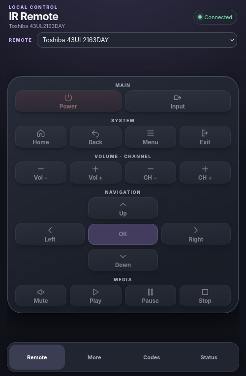

# ESP32 WiFi IR Remote

A fully local, browser-based universal IR remote for the Seeed Studio XIAO ESP32C3 and classic ESP32 DevKit. The default build targets a XIAO ESP32C3 with the IR transistor on **D10/GPIO10**. It creates an always-on, open WiFi access point and presents a phone-friendly remote through the captive portal or `http://192.168.4.1/`.



The project ships with two **uncoded templates**: a Toshiba 43UL2163DAY TV and a generic media player. Their button layouts are different. No unverified device codes are claimed to work; add codes from your original remote before expecting IR control.

## Features

- Multiple remote profiles, each in its own LittleFS JSON file with its own pages, groups, visible buttons, hold behavior and IR codes.
- Profile picker, layout cloning, JSON editing, import, export and deletion in the web app.
- Mobile-first dark interface, local SVG icons, and gzip-compressed assets embedded in firmware. No CDN, cloud, login page or separate app.
- Open, always-on 2.4 GHz AP with captive DNS and direct redirect to the remote.
- REST API restricted to clients on the AP subnet, a four-command IR queue and rate limiting.
- NEC, Sony, RC5, RC6 and RAW send modes, with carrier frequency per command or profile.
- Optional IR receiver and browser-assisted learning, including RAW fallback (disabled in the default XIAO build).
- Atomic profile saves with `.bak` fallback, protected local ArduinoOTA and serial diagnostics.

## Build and connect

1. Install [PlatformIO](https://platformio.org/install), Python 3 and GNU Make. Connect the XIAO ESP32C3 over USB. The classic DevKit build is available with `make build BOARD=esp32dev`.
2. Run `make build` to generate the embedded gzip assets and factory profile header, then compile. Run `make flash 0` for `/dev/ttyACM0`, or `make flash PORT=/dev/serial/by-id/...` for a stable path. `make run 0` also opens the serial monitor. The Makefile workflow follows [AutomaticChickenFeeder](https://github.com/Friedjof/AutomaticChickenFeeder).
3. Connect your phone to the open `TV-Remote-XXXX` WiFi network. Its suffix comes from the board's MAC address, so a different board has a different SSID. The sign-in window should open the remote automatically. Otherwise visit `http://192.168.4.1/`. If the phone says the network has no internet, choose to stay connected.
4. Use **Codes** to select, clone, edit or import a profile. Assign IR codes to the commands you need. An unconfigured command returns a clear error and emits no IR.
5. Run `make monitor 0` at 115200 baud to see AP diagnostics and the per-device OTA password. Press reset to repeat the boot log.

The web assets and factory profiles are compiled into the firmware. No `uploadfs` step is required. On first boot the two factory profiles are copied to `/remotes/*.json` in LittleFS. Subsequent firmware uploads leave edited profiles intact. An explicit `uploadfs`, full erase or changed partition scheme may remove them; download each profile before those operations.

### Existing installations

On an ESP32 that already has the earlier single `/config.json`, the firmware migrates its saved codes and settings into `/remotes/toshiba_tv.json` on first boot, then adds the media-player template. The old file remains as a recovery copy. The selected profile ID is stored in NVS and restored after restart.

## Profile format

Each JSON file has a stable lowercase `id`, a displayed `device` name, IR settings, `commands`, and the pages and buttons shown in the app. See [toshiba_tv.json](data/profiles/toshiba_tv.json) and [media_player.json](data/profiles/media_player.json) for complete examples. The factory files are templates, not working code sets.

```json
{
  "id": "my_receiver",
  "device": "Living room receiver",
  "default_frequency": 38000,
  "repeat_interval_ms": 250,
  "receiver_enabled": false,
  "pages": [{
    "id": "remote",
    "label": "Remote",
    "groups": [{
      "label": "MAIN",
      "columns": 2,
      "buttons": [
        {"command": "power", "label": "Power", "icon": "power"},
        {"command": "volume_up", "label": "Volume +", "icon": "plus", "repeat": true}
      ]
    }]
  }],
  "commands": {
    "power": {"protocol": "NEC", "code": null, "bits": 32},
    "volume_up": {"protocol": "NEC", "code": null, "bits": 32}
  }
}
```

A button only appears if listed in a page group, and its `command` must exist under `commands`. Groups accept 1–4 columns. Optional button fields are `icon`, `tone`, `repeat`, `span`, `column` and `row`. The last three control grid placement. The supported icons are the SVG symbols in `data/index.html`; unknown icons simply fall back to the label. Cloning the current layout creates a new profile with its IR codes cleared.

Encoded protocols require a hexadecimal `code` string and 1–64 `bits`. RAW commands use an array of alternating mark/space microsecond `timings` and an optional 30–60 kHz `frequency`. The value `null` or an empty RAW timing array means unconfigured. A profile can have up to 96 commands and visible buttons; up to eight profiles can be stored. Hold repeat interval is 120–1000 ms.

## Hardware and access

The XIAO's D10/GPIO10 drives the IR LED through a transistor; never drive a high-current IR LED directly from the GPIO. See [hardware.md](docs/hardware.md) for wiring and receiver options. The classic `esp32dev` environment uses GPIO18 for transmit and GPIO27 for optional receive.

The AP does not connect to your home router. Anyone who joins this open WiFi can use the remote and change profiles. ArduinoOTA has a separate per-device password in NVS. The firmware makes no cloud or telemetry requests.

## Documentation

- [HTTP API](docs/api.md)
- [IR learning](docs/ir-learning.md)
- [Hardware](docs/hardware.md)

Tested build stack: PlatformIO Espressif 32 7.0.0, Arduino-ESP32 2.0.17, IRremoteESP8266 2.9.0 and ArduinoJson 7.4.3. Actual device control requires verified IR codes and a working LED circuit.
