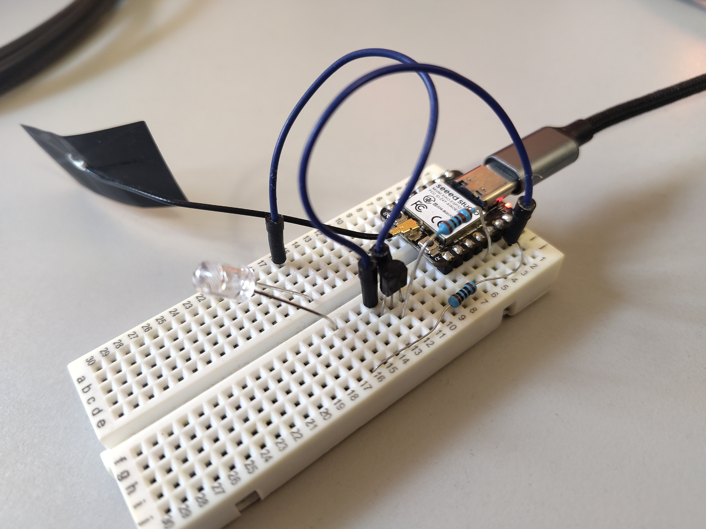

# Hardware and wiring



## IR transmitter

```text
XIAO ESP32C3 D10/GPIO10 -- 1 kΩ -- base (2N2222)
ESP32-C3 GND ---------------- emitter (2N2222)
                             collector -- IR LED cathode
+5 V -- 100 Ω -- IR LED anode
+5 V GND ------------------- ESP32-C3 GND
```

The example values are a starting point. Check the chosen IR LED's forward voltage, pulse current, duty cycle and resistor power rating before use. Check the transistor's collector current and pinout. Use a regulated supply with a common ground. Do not drive the IR LED directly from D10/GPIO10. The classic ESP32 DevKit build uses GPIO18 instead. NEC, Sony and RAW use their configured carrier frequency; RC5 and RC6 transmit at the protocol's 36 kHz carrier. RAW can preserve the duty cycle from a Flipper file.

The [Seeed Studio XIAO ESP32C3 pin map](https://wiki.seeedstudio.com/XIAO_ESP32C3_Getting_Started/) maps D10 to GPIO10. Follow [Seeed's WiFi setup instructions](https://wiki.seeedstudio.com/XIAO_ESP32C3_WiFi_Usage/) and attach the supplied external antenna to the board's IPEX connector before the first setup. A missing or loose antenna can make the setup AP difficult or impossible to receive.

## Optional IR receiver

```text
3.3 V ---- receiver VCC
GND ------ receiver GND
GPIO3 (example C3 pin) --- receiver OUT
```

Use a demodulating receiver rated for 3.3 V, such as a suitable TSOP38238 variant. Follow its datasheet for recommended supply decoupling and orientation. The receiver should not be exposed to the transmitting LED during learning if that causes echoes. The ESP32-C3 build has `IR_ENABLE_RX=0` by default; set it to `1`, verify the selected GPIO, rebuild, then set `receiver_enabled` in the configuration. The classic ESP32 DevKit build uses GPIO27.

## Verification

After adding a known code, use a phone camera that can see infrared or an IR receiver to confirm D10/GPIO10 drives the LED on the XIAO ESP32C3. A camera check proves light output only; correct TV control requires the actual remote's protocol and code. Confirm the open `TV-Remote-XXXX` AP remains visible and test the captive page on the phone you intend to use. If home WiFi is configured, confirm that both the AP URL and `http://tv-remote.local/` (or the reported station IP) work after a restart and a router interruption.
